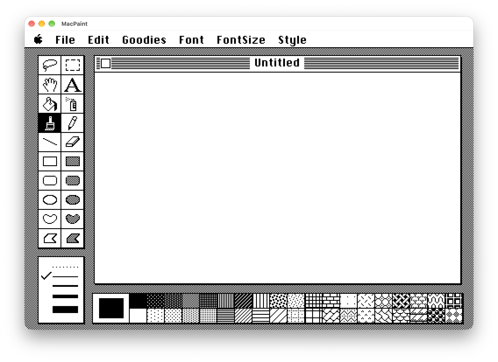

<p align="center"><a href="README.md">English</a> · <a href="README.ru.md">Русский</a> · <a href="README.zh.md">简体中文</a> · <a href="README.ja.md">日本語</a></p>

<h1 align="center">🖌️ MacPaint Native</h1>
<p align="center"><b>Apple の 1984 年オリジナル MacPaint を現代の Mac へネイティブ移植</b></p>

<p align="center">
  
  
  
  
  
  
  <a href="https://imedfan.github.io/MacPaint/"></a>
</p>

<p align="center"><a href="https://imedfan.github.io/MacPaint/"><b>🌐 imedfan.github.io/MacPaint</b></a></p>

<p align="center"></p>

## ✨ 制作について

MacPaint Native は**エミュレーターではありません**。コンピュータ歴史博物館（Computer History Museum）が公開した Apple の歴史的な **MacPaint 1.3 ソースコード**（Pascal と 68000 アセンブリ）をもとに、Swift で書かれた新しいネイティブ macOS アプリです。移植は **OpenAI Codex** を使って行われました。オリジナルのコードをルーチンごとに読み解き、その動作をネイティブに再実装しています——1 ビットのページビットマップ、QuickDraw 風の線・図形・楕円、ツールパレット、パターン、メニュー、ダイアログ、そして MacPaint ドキュメント形式。

オリジナルのリソース（メニュー、ダイアログ、アラート、文字列、パターン、ヘルプ画像、アイコン、ビットマップフォント——`MacPaintNative/Resources` 内の 140 以上のファイル）は歴史的アーカイブから抽出され、実行時に読み込まれます。そのため外観も動作も 1984 年のオリジナルとピクセル単位で一致します。

## 🧰 技術スタック

| | |
|---|---|
| **言語** | Swift 5 |
| **UI** | AppKit（`NSView` でクラシックな 1 ビットのワークスペースを独自描画、ネイティブのメニューバーはクラシックメニューを反映） |
| **グラフィックス** | 独自の 1 ビット `Bitmap` ラスターエンジンと QuickDraw 風プリミティブ（線、矩形、角丸矩形、楕円、多角形、塗りつぶし、パターン） |
| **テキスト** | オリジナルの Macintosh ビットマップフォント（`FONT`/`FOND` リソース）を `BitmapText` で描画 |
| **ビルド** | Xcode プロジェクト、ターゲット `MacPaintNative`、macOS 15.0+、arm64 |
| **元資料** | Apple MacPaint 1.3 のソースとリソース（コンピュータ歴史博物館） |
| **開発ツール** | OpenAI Codex |

## 🎨 機能

### ツール——オリジナルのパレットすべて（20 種）

| ツール | 説明 |
|---|---|
| 投げなわ | 自由形状の選択 |
| 選択矩形 | ドラッグで移動、⌥ドラッグで複製、⌘ドラッグで伸縮 |
| 手のひら | ウインドウ内でページをスクロール |
| テキスト | ビットマップ文字：フォント、サイズ、スタイル、揃え |
| ペイント缶 | 現在のパターンで塗りつぶし |
| スプレー | 現在のパターンを吹き付け |
| ブラシ | ブラシ形状の選択、Brush Mirrors による対称描画 |
| 鉛筆 | 1 ピクセルのフリーハンド |
| 直線 | 選択した線幅で直線 |
| 消しゴム | 白で消去 |
| 矩形 · 塗り矩形 | 枠線またはパターン塗り |
| 角丸矩形 · 塗り | 枠線またはパターン塗り |
| 楕円 · 塗り楕円 | QuickDraw 風の楕円 |
| 自由曲線 · 塗り | 閉じたフリーハンド図形 |
| 多角形 · 塗り多角形 | クリックで頂点追加、始点で閉じる |

修飾キーはオリジナルどおり：**Shift** で線や図形を制約、**Option** で現在のパターンで枠線を描画、**Option ドラッグ**で選択範囲を複製、**⌘ドラッグ**で伸縮。

### メニュー

| Menu | |
|---|---|
| **File** | New · Open · Close · Save · Save As · Revert · Print Draft · Print Final · Print Catalog · Quit |
| **Edit** | Undo ⌘Z · Cut ⌘X · Copy ⌘C · Paste ⌘V · Clear · Invert · Fill · Trace Edges ⌘E · Flip Horizontal · Flip Vertical · Rotate |
| **Goodies** | Grid · FatBits · Show Page · Edit Pattern · Brush Shape · Brush Mirrors · Introduction · Short Cuts |
| **Font** | Chicago · Geneva · New York · Monaco · Times · Helvetica · Courier |
| **FontSize** | 9 · 10 · 12 · 14 · 18 · 24 · 36 · 48 · 72 |
| **Style** | Plain ⌘P · Bold ⌘B · Italic ⌘I · Underline ⌘U · Outline ⌘O · Shadow ⌘S · Align Left ⌘L / Middle ⌘M / Right ⌘R |

### その他

- 本物の **MacPaint ドキュメント**（`.mac`、`.pntg`、`.paint`、`.mpnt`、タイプ `PNTG`）を開いて保存。MacBinary 形式やカスタムパターン付きの書類にも対応
- クラシックなパターンパレットと **Edit Pattern**、線幅パレット、**Brush Shape** と **Brush Mirrors** ダイアログ
- **FatBits** 拡大、**Grid**、ページ全体を見る **Show Page**
- Undo、Invert、Fill、Trace Edges（Shift で影付き）、Flip、Rotate
- システムの**クリップボード**と連携（画像とテキスト）
- **クラッシュ復旧**：未保存の作業をスナップショットし、次回起動時に復元
- 1984 年のリソースから描画されるオリジナルのダイアログ、アラート、ヘルプ画面（*Introduction*、*Short Cuts*）
- macOS 経由の印刷：Print Draft、Print Final、Print Catalog

## 🛠️ ビルドと実行

**必要環境：** macOS 15 以降、Apple Silicon（arm64）、Swift 5 対応の Xcode。

```bash
git clone https://github.com/imedfan/MacPaint.git
cd MacPaint/MacPaintNative
xcodebuild -project MacPaintNative.xcodeproj -target MacPaintNative -configuration Release build
open build/Release/MacPaintNative.app
```

アプリにはセルフチェックが組み込まれています：

```bash
APP=build/Release/MacPaintNative.app/Contents/MacOS/MacPaintNative
"$APP" --verify-model /tmp/macpaint-model   # ウインドウなしのモデル・ラスター検査
"$APP" --verify /tmp/macpaint-ui            # グラフィカル検証
```

## 📁 プロジェクト構成

```text
MacPaint/
├── COPYRIGHT.TXT                  # Apple の著作権表示（非商用のみ）
├── MacPaintNative/
│   ├── Info.plist                 # バンドル情報、ドキュメントタイプ
│   ├── MacPaintNative.xcodeproj/
│   ├── Resources/                 # オリジナルの MacPaint・System リソース、アイコン
│   └── Sources/
│       ├── main.swift             # エントリポイント、検証フラグ
│       ├── AppController.swift    # メニュー、書類、クリップボード、印刷
│       ├── WorkspaceView.swift    # クラシックなワークスペース：パレット、ウインドウ、メニュー
│       ├── PaintModel.swift       # ドキュメントモデルとツールロジック
│       ├── Bitmap.swift, QuickDrawOval.swift   # 1 ビットラスター、QuickDraw 楕円
│       ├── BitmapText.swift       # ビットマップフォント
│       ├── MacPaintFile.swift     # MacPaint ファイル形式（+ MacBinary）
│       ├── ClassicResources.swift, ClassicDialogView.swift  # リソース読み込み、クラシックダイアログ
│       ├── PageOverview.swift     # Show Page
│       ├── PaintCatalog.swift, CatalogPrintView.swift, PrintRaster.swift  # カタログと印刷
│       ├── RecoveryStore.swift    # クラッシュ復旧
│       └── *Verification.swift    # セルフチェック
└── docs/                          # GitHub Pages サイト
```

## ⚖️ 法的事項

- 本プロジェクトは**非公式・非商用のファンプロジェクト**です。**Apple Inc. とは一切関係がなく、承認・後援も受けていません**。
- **MacPaint**、Apple、Macintosh は Apple Inc. の商標です。
- MacPaint のオリジナルソースコードは **© 1984 Apple Inc.** であり、**[コンピュータ歴史博物館](https://computerhistory.org/blog/macpaint-and-quickdraw-source-code/)** の厚意により、同館のライセンスのもと非商用目的に限り公開されています（[`COPYRIGHT.TXT`](COPYRIGHT.TXT) 参照）。本プロジェクトも同じ条件で配布されます——商用利用は禁止です。
- 一部の補助素材は Executor のライセンスで含まれています（`MacPaintNative/Resources/Executor-COPYING.txt`）。
- **Apple またはその他の権利者から異議があった場合、このリポジトリは速やかに削除します。** [GitHub Issues](https://github.com/imedfan/MacPaint/issues) からご連絡ください。

---

<p align="center">1984 年の Macintosh に ❤️ を込めて · <a href="https://imedfan.github.io/MacPaint/">imedfan.github.io/MacPaint</a></p>
